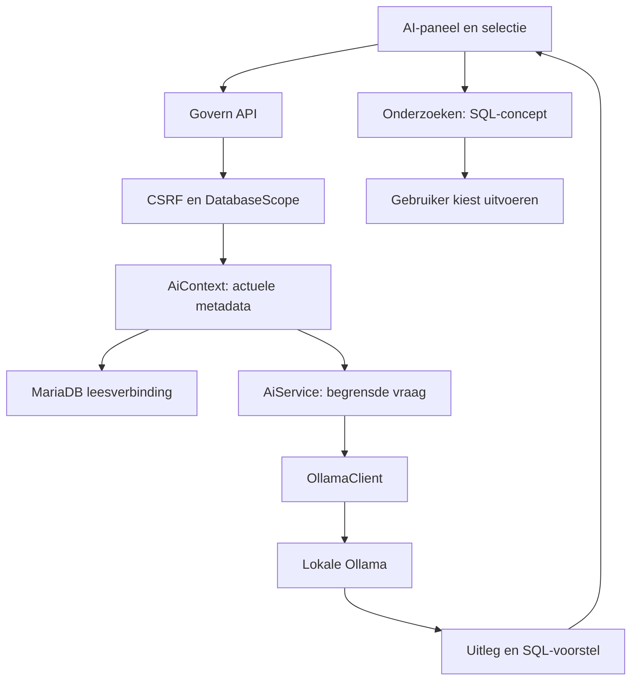

# Lokale AI in Govern

Govern heeft een optioneel AI-paneel voor uitleg over de gekozen database en
geselecteerde onderdelen. De interface en backend vormen een eerste, beperkte
koppeling met een lokale Ollama-installatie. AI staat standaard uit; de gewone
werkplek blijft zonder Ollama werken.

De eerste versie gebruikt actuele schema-informatie en zichtbare
interfacebeschrijvingen. Ze kan uitleg en een SQL-voorstel teruggeven. Het model
heeft geen databaseverbinding, shell, internetzoekfunctie of uitvoerbare tools.
Een antwoord wordt nooit automatisch een databasehandeling.

## Gebruikersstroom

1. Open het AI-paneel bovenaan, of kies **Vraag AI** vanuit de selectie-uitleg.
2. Controleer de database, gekozen onderdelen en gebruikte bronnen.
3. Stel een vraag in Nederlands of Engels. Het paneel toont de werkelijke
   verbindingsstatus voordat versturen beschikbaar wordt.
4. Lees de uitleg. Een SQL-voorstel heeft een aparte actie om het in
   **Onderzoeken** klaar te zetten. Een bestaand gewijzigd concept volgt de
   gewone bevestiging voor vervangen.
5. Bekijk en bewerk de SQL daar. Uitvoeren blijft de bestaande gebruikersactie.

Het paneel deelt de glasmaterialen en vertalingen van Govern. Het is op desktop
een tijdelijk paneel naast het werk en op een klein scherm een dialoog.
Gesprekken en concepten blijven tijdens het open browsertabblad per database
apart in geheugen. Ze worden niet als databasegegevens of in browseropslag
bewaard. Herladen begint een nieuwe gespreksessie.

Een databasewissel breekt het zichtbare AI-verzoek af en negeert een laat
antwoord voor de vorige database. **Stop wachten** stopt het wachten in de browser;
dat garandeert niet dat een reeds begonnen berekening in Ollama direct stopt.
Een verbindingsfout behoudt de vraag en biedt opnieuw proberen.

## Architectuur



De onderdelen blijven in de bestaande PHP- en JavaScriptstructuur:

- `ai-workspace.js` beheert paneel, vraag, verbinding en gespreksgeschiedenis.
  `app.js` verbindt het met databasewissels, selectie en Onderzoeken.
- `AiConfig` leest uitsluitend serverconfiguratie. Een browserbericht kan geen
  provideradres, modelpad of toegangsrechten veranderen.
- `AiContext` bouwt begrensde context uit de actuele catalogus van de expliciet
  gekozen database. Het model krijgt geen databasewachtwoord.
- `AiService` controleert vraag en geschiedenis, maakt de modelinvoer en
  controleert het antwoord. Het verwerkt geen uitvoerbare modelacties.
- `OllamaClient` handelt de lokale HTTP-aanroepen af met tijd- en groottelimieten.

Het opbouwen van context gebruikt de bestaande gedeelde onderhoudslock. De API
laat die lock los voordat de modelaanroep begint. Een lang AI-antwoord houdt
daardoor geen databaseherstel tegen. `completeChat` gebruikt de gemaakte
momentopname en leest de database niet opnieuw. De bronnen horen bij die
momentopname; ze bewijzen niet dat records sinds die tijd ongewijzigd zijn.

## Welke context krijgt het model?

De API gebruikt dezelfde expliciete `database`-parameter als de andere
werkplaatsverzoeken. Tabel- en kolomnamen worden opnieuw gecontroleerd tegen
de catalogus. Een selectie uit de browser is een verzoek om context, geen
betrouwbare kopie van de database.

De eerste versie neemt alleen de ondersteunde selectievelden, schema en
begrensde beschrijvingen van interfaceonderdelen mee. Rijen, celwaarden,
recordsleutels, queryresultaten, opgeslagen onderzoeken, appconfiguratie en
credentials worden niet automatisch als context toegevoegd. Het contextantwoord
meldt `records_included: false` en laat verkorting zien.

Er passen maximaal acht gekozen onderdelen in één verzoek. De hele
contextmomentopname blijft binnen 6.000 UTF-8 bytes; de bronvermelding houdt
weggelaten kolommen en relaties bij. Een vraag is maximaal 4.000 bytes.
Voor een vervolgvraag gaan alleen recente berichten voor dezelfde context mee,
maximaal acht en samen 4.000 bytes; oudere of te grote berichten vallen buiten
die modelinvoer. De zichtbare sessie bewaart maximaal veertig berichten per
database. Dit zijn beperkte gesprekken, geen onbeperkt modelgeheugen.

Zelf getypte vragen en gespreksgeschiedenis worden uiteraard wel naar de
gekozen lokale provider gestuurd. De bronvermelding beschrijft wat Govern
toevoegt; ze is geen filter dat door de gebruiker getypte informatie verwijdert.
Schema-commentaren en andere broninhoud blijven onbetrouwbare gegevens en
worden als zodanig aan het model gepresenteerd, niet als systeeminstructies.

De bestaande **Context exporteren**-download blijft apart: die bevat schema en
opgeslagen onderzoeken. De AI-koppeling verruimt die export niet ongemerkt.

## Ollama aansluiten

Ollama wordt niet door Govern geïnstalleerd en Govern downloadt geen modellen.
Kies een lokaal model dat op de computer past en test de snelheid met een korte
vraag. `qwen3:4b-instruct` is de voorgestelde begininstelling; dat is geen
garantie voor kwaliteit of snelheid op iedere laptop.

1. Installeer [Ollama voor Windows](https://ollama.com/download/windows).
2. Download het gekozen model bewust, bijvoorbeeld in PowerShell:

   ```powershell
   ollama run qwen3:4b-instruct
   ```

3. Schakel in de Ollama-server cloudfuncties uit met `OLLAMA_NO_CLOUD=1` en
   herstart Ollama. Dit is een instelling van Ollama zelf, niet van Govern.
4. Zorg dat de Govern-appcontainer de lokale Ollama-server kan bereiken; zie
   de netwerkgrens hieronder.
5. Voeg aan Governs bestaande `.env` toe, met behoud van de databasewachtwoorden:

   ```dotenv
   AI_ENABLED=1
   AI_BASE_URL=http://host.docker.internal:11434
   AI_MODEL=qwen3:4b-instruct
   AI_TIMEOUT_SECONDS=60
   ```

6. Start Govern opnieuw met `start.cmd` of `sh start.sh`. Open
   **Instellingen → Lokale AI** en controleer de verbinding en het model.
   De status is pas **Gereed** wanneer de lokale server en dat model beschikbaar
   zijn. Een uitgeschakelde koppeling doet geen providerverzoek.

`AI_ENABLED=0` schakelt de koppeling weer uit na herstart. Vragen kunnen dan niet
worden verstuurd; de databasewerkplek en gewone selectie-uitleg blijven bruikbaar.

### Windows en Docker zijn verschillende netwerkcontexten

In de appcontainer wijst `localhost` naar de container zelf. Voor een Ollama-app
op Windows gebruikt de opzet `host.docker.internal`. De standaardbinding van
Ollama aan `127.0.0.1` betekent niet automatisch dat de Docker-container die
poort kan bereiken.

Controleer daarom de werkelijke route en firewall voordat je de AI gebruikt.
Maak alleen een privé-interface bereikbaar voor Docker Desktop en beperk de
toegang in Windows Firewall tot de benodigde lokale route. Publiceer Ollama niet
op internet en voeg geen algemene router-forwarding of onbeperkte
`0.0.0.0`-binding toe als standaardoplossing. Governs adrescontrole voorkomt geen
verkeerd ingestelde Ollama-server of hostfirewall.

Een mogelijke latere installatievorm is Ollama als afzonderlijke service op het
private Compose-netwerk, zonder gepubliceerde hostpoort. De app kan dan
`http://ollama:11434` gebruiken en modellen krijgen een eigen volume. Die service
wordt in deze opzet niet automatisch toegevoegd of gevuld. GPU-toegang en
geheugengebruik moeten voor de gekozen machine apart worden gecontroleerd.

## Status en fouten

- **Uitgeschakeld:** de beheerder heeft AI niet ingeschakeld. Toon de setupstappen.
- **Niet bereikbaar:** de server antwoordt niet binnen de verbindingsgrens.
  Behoud de vraag en bied een verbindingstest.
- **Model ontbreekt:** de server is bereikbaar, maar het ingestelde model is
  niet beschikbaar. Een statuscontrole downloadt niets.
- **Gereed:** de server meldt het ingestelde lokale model als beschikbaar.
  Dit voorspelt niet of iedere volgende generatie zal slagen.
- **Antwoord mislukt:** toon een bruikbare fout, behoud het concept en bied
  opnieuw proberen. Een verkeerd gevormd of te groot modelantwoord wordt niet
  als geldige SQL-actie weergegeven.

De serverconfiguratie staat buiten de browser. Er is geen automatisch uitwijken
naar een cloudmodel. De API accepteert alleen de ondersteunde lokale adressen
en weigert redirects en bekende cloudmodelnamen. Ze kan niet controleren hoe
een zelfgemaakte Ollama-alias intern werkt of bewijzen dat de cloudinstelling
van Ollama uit staat. Stel daarom ook `OLLAMA_NO_CLOUD=1` in de lokale server in.
Ook bij een lokale provider is een
gegenereerd antwoord een voorstel, geen bewijs of vertrouwde opdracht.

## Volgende uitbreidingen

Voeg iedere uitbreiding toe met een afzonderlijk API-contract en een volledige
gebruikersstroom. Houd de gewone werkplek bruikbaar wanneer de uitbreiding uit
staat of mislukt.

1. **Gerichte gegevensvragen:** voeg expliciete, begrensde leesfuncties toe met
   de bestaande leesverbinding en echte databaserechten. Hergebruik de vrije
   `QueryRunner` niet als automatische AI-tool: die kan inmiddels schrijven.
   Toon welke rijen als bron zijn gebruikt. Willekeurige door het model
   geschreven SQL is geen vervanging voor die leesgrens.
2. **Lokale documenten:** voeg zoeken met bronpassages en afzonderlijke opslag
   toe wanneer documenten nodig zijn. Dit vraagt geen hertraining van het model.
3. **Een andere provider:** behoud het frontendcontract, de contextgrens,
   foutcodes en SQL-conceptstroom. Maak providerkeuze expliciet aan de serverkant;
   voeg geen onzichtbare fallback toe.
4. **Gesprekken langer bewaren:** ontwerp eerst bewaren, verwijderen en herstel
   per database. De huidige tijdelijke geschiedenis wordt niet stilzwijgend
   permanent opgeslagen.

Test nieuwe mogelijkheden met onjuiste kolomnamen, grote context, onbetrouwbare
broninhoud, databasewissels tijdens wachten, taalwisseling, stop/herhalen en
een onbereikbare provider. Een lokale fixture bewijst de applicatiestroom;
kwaliteit en snelheid van een echt model op de gebruikercomputer blijven een
aparte proef. Zie [het API-contract](API.md) en [de validatie](VALIDATION.md).

## Officiële bronnen

- [Ollama op Windows](https://docs.ollama.com/windows)
- [Ollama chat-API](https://docs.ollama.com/api/chat)
- [Beschikbare modellen opvragen](https://docs.ollama.com/api/tags)
- [Ollama-configuratie, cloud uitschakelen en netwerkbinding](https://docs.ollama.com/faq)
- [Netwerkverkeer van Docker Desktop](https://docs.docker.com/desktop/features/networking/)
