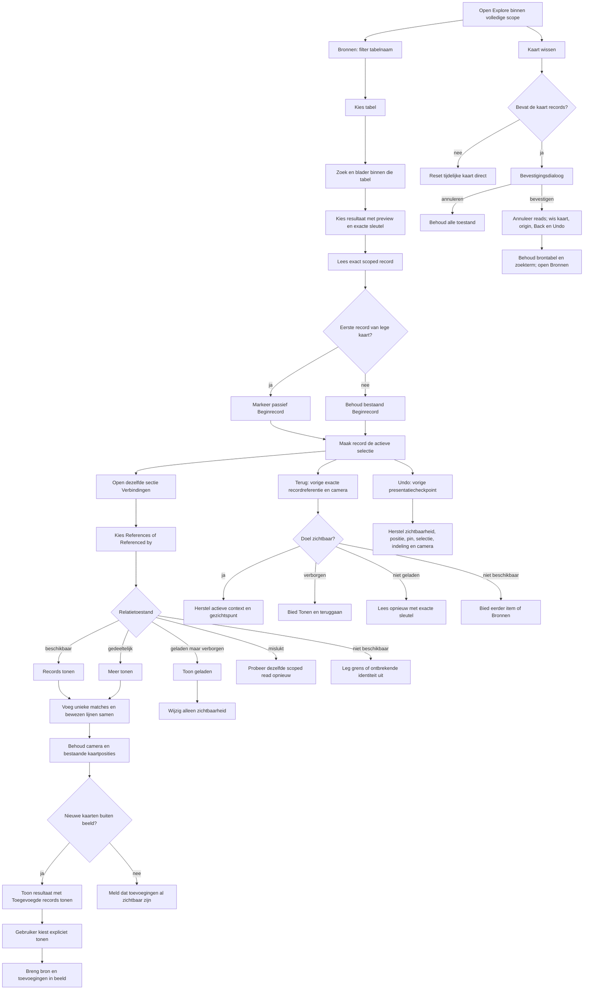
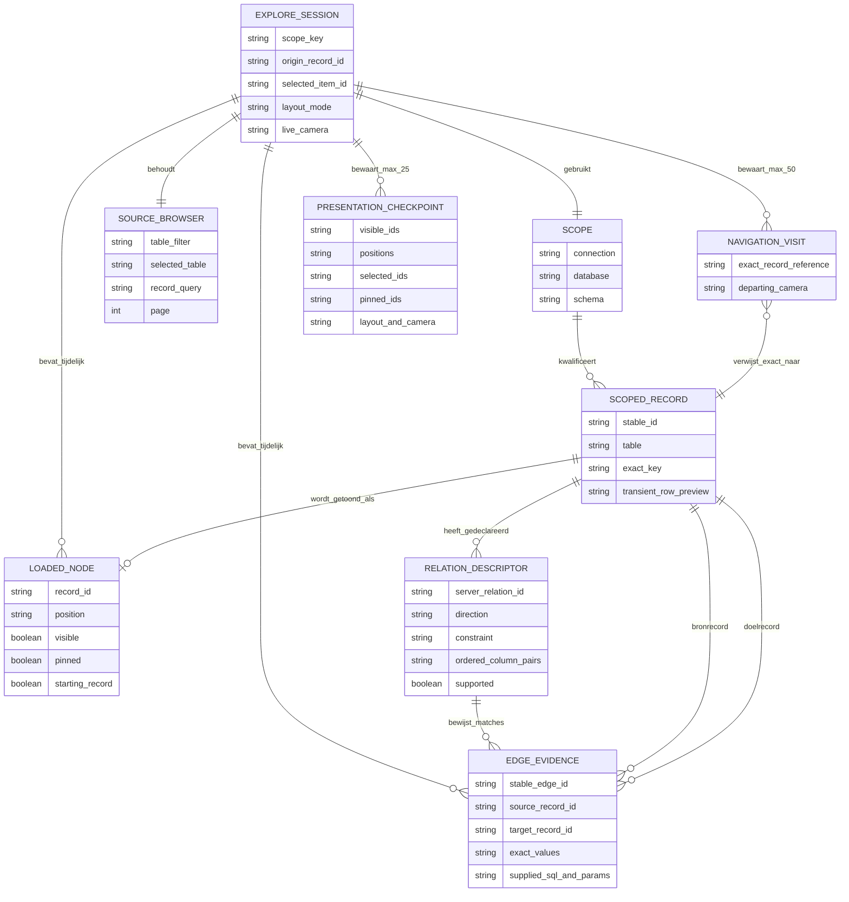

# Explore: records en verbindingen

Explore toont echte records binnen de gekozen database en het gekozen schema.
Een kaart is één herkenbaar record. Een lijn ontstaat wanneer records bij
elkaar passen volgens een gedeclareerde foreign key. Indeling en verplaatsing
vertellen niets over belang, afstand of oorzakelijkheid.

## Waar staat wat?

- **Database → Records:** gewone tabelrijen bekijken, zoeken en bewerken.
- **Database → Explore:** records selecteren, verbindingen volgen en inspecteren.
- **Database → Schema:** tabeldetails en het schemadiagram.
- **Database → Tools:** import, export en herstelpunten. Import/export gebruikt
  de bestaande officiële phpMyAdmin-integratie waar deze beschikbaar is.
- **Onderzoeken:** querybouwer, SQL en opgeslagen onderzoeken.

De databasekiezer blijft bovenaan staan. De route voor Explore is `#verkennen`;
een oude `#verbanden`-link opent dezelfde werkplek. Schema blijft over tabellen
gaan; Explore gaat over hun records.

## Logische opbouw en wireframes

De interface volgt een vaste informatiereeks: eerst bron en herkenning, daarna
één actieve recordcontext, vervolgens bewezen verbindingen en pas daarna
technische herkomst. De permanente bovenbalk bevat daarom alleen acties voor de
hele Explore-werkplek. Bronnen en de inspecteur zijn ondersteunende panelen in
het canvas. De selectieacties en camerabediening blijven dicht bij de kaarten.
Hierdoor hoeft een gebruiker niet tussen een aparte vragenlaag, een tweede
tabelkiezer en een inspecteur te vertalen.

Op een canvas van minimaal 900 px kunnen Bronnen en de inspecteur tegelijk open
zijn. Dit wireframe toont de maximale desktopopstelling; beide panelen kunnen
onafhankelijk worden gesloten. De resultaatmelding verschijnt alleen na een
verbindingsactie en verplaatst de camera niet zelf.

```text
┌──────────────────────────────────────────────────────────────────────────────┐
│ Database / scope                 Records | Explore | Schema       Tools      │
├──────────────────────────────────────────────────────────────────────────────┤
│ De kaart toont geopende records.  [Bronnen] [Zichtbare tabellen]             │
│                                   [Meer acties]              [Kaart wissen]  │
├──────────────────────────────────────────────────────────────────────────────┤
│ Explore vrij.  [Terug] [Terug naar beginrecord]   [Undo] [Panelen verbergen]│
│                                                                              │
│ ┌─ Bronnen ───────────────┐                         ┌─ Recordinspectie ─────┐ │
│ │ Filter tabellen…        │                         │ tabel + recordlabel    │ │
│ │ Tabel [projecten      ▾]│                         │ [Beginrecord]          │ │
│ │ Zoek in Projecten…      │                         │ herkenningsvelden      │ │
│ │                        │                         │                        │ │
│ │ Project Alpha           │  ┌──────────┐           │ Verbindingen           │ │
│ │ naam · status           │  │ Persoon A│──FK──────▶│ Verwijst naar          │ │
│ │ id: 11                  │  │ Beginrec.│           │  Organisaties          │ │
│ │                        │  └─────┬─[+]┘           │  Beschikbaar           │ │
│ │ Project Beta            │        │                │  [Records tonen]       │ │
│ │ id: 12                  │        ▼                │ Verwezen door          │ │
│ │               [1] [2]   │  ┌──────────┐           │  Taken · 25 geladen    │ │
│ └─────────────────────────┘  │ Project A│           │  [Meer tonen]          │ │
│                              └──────────┘           │ [Bekijk record]        │ │
│                                                     │ Meer acties            │ │
│       [2 records toegevoegd] [Toegevoegde records tonen]                    │ │
│                                                     │ Technische details     │ │
│ [Project A] [Verbindingen tonen] [Vastzetten] [Verbergen]                  │ │
│                 [Selecteer] [Verschuif] [Rondom ▾]  − 100% + [Alles in beeld]│
│                                                     └───────────────────────┘ │
├──────────────────────────────────────────────────────────────────────────────┤
│ ▸ Geladen records                                                            │
└──────────────────────────────────────────────────────────────────────────────┘
```

Onder 600 px wordt hetzelfde systeem één kolom. Bronnen en de inspecteur worden
onderladen die elkaar vervangen; zij vormen geen tweede pagina en overlappen
elkaar niet. Terug, het beginanker, Undo en Panelen verbergen blijven boven het
canvas zichtbaar. De selectie- en camerabediening blijven onderaan bereikbaar.
Een resultaatmelding staat boven de open lade of boven de onderste bediening.

```text
┌──────────────────────────────┐
│ Database                     │
│ Records | Explore | Schema   │
├──────────────────────────────┤
│ [Bronnen] [Zichtbare tabellen│
│ [Meer acties] [Kaart wissen] │
├──────────────────────────────┤
│ Explore vrij.                │
│ [Terug] [Naar beginrecord]   │
│                  [Undo]      │
│                  [Panelen    │
│                   verbergen] │
│                              │
│       ┌────────────────┐     │
│       │ Project Alpha  │     │
│       │ Beginrecord [+]│     │
│       └────────────────┘     │
│                              │
│ [1 record toegevoegd] [Toon]│
│ [Project Alpha] [Verbergen]  │
│ [Selecteer][Verschuif][100%] │
│                              │
│ ┌─ één open onderlade ─────┐ │
│ │ Bronnen       of         │ │
│ │ Recordinspectie          │ │
│ │ Verbindingen             │ │
│ │ [Records tonen]          │ │
│ │ [Sluiten]                │ │
│ └──────────────────────────┘ │
├──────────────────────────────┤
│ ▸ Geladen records            │
└──────────────────────────────┘
```

## Systematische interactielogica

De volgende stroom laat zien waar toestand wel en niet verandert. Een
bronfilter verandert alleen de bronlijst. Een exacte recordselectie verandert
de actieve context, kan een kaart toevoegen en mag die gekozen kaart minimaal
naast het geopende paneel zichtbaar maken. Een verbindingsactie kan records en
bewezen lijnen toevoegen, maar bewaart de live camera. Alleen de expliciete
actie **Toegevoegde records tonen** brengt zo'n nieuwe tak in beeld; de overige
presentatieacties regelen zichtbaarheid en gezichtspunt bewust. Kaart wissen is
de enige actie in deze stroom die de hele tijdelijke kaart na bevestiging leegt.



## Conceptueel gegevensmodel

Dit ERD is een model van de gegevensgrenzen van Explore en geen nieuw
databaseschema. **Scoped record**, **relation descriptor** en **edge evidence**
komen uit beperkte serverreads en blijven alleen tijdelijk in het geheugen van
de huidige pagina. **Navigation visit** en **presentation checkpoint** bewaren
uitsluitend verwijzingen en presentatiegegevens. Zij bevatten geen kopie van een
rij, SQL-resultaat of oude paginacursor. Geen van deze entiteiten wordt door
Explore in browseropslag of in de brondatabase geschreven.



De kardinaliteiten drukken de logica van de tijdelijke kaart uit. Eén volledige
scope heeft meerdere exacte records; één geladen kaart kan slechts naar records
uit diezelfde scope verwijzen. Een gedeclareerde relatie kan nul of meer
bewijsbare lijnen opleveren. Dezelfde exacte recordreferentie kan vaker in Back
voorkomen met een ander verlaten gezichtspunt. Het beginrecord staat als
rechtstreeks anker in de sessie en blijft daardoor bereikbaar wanneer zijn oude
Back-item al buiten de grens van 50 is gevallen. Een presentatiecheckpoint kan
een kaart weer tonen of verbergen, maar heeft bewust geen relatie naar oude
recordinhoud of relatiecursors.

## Beginnen vanuit Bronnen

1. Open **Database → Explore** en open **Bronnen / Sources**.
2. Filter de tabellen, kies één tabel en zoek daarna alleen binnen die tabel.
   De tabelzoeker en recordzoeker hebben ieder hun eigen bereik.
3. Herken een resultaat aan het leesbare label en maximaal twee compacte
   voorbeeldvelden. De volledige sleutel staat ook bij ieder bronresultaat.
4. Kies het record. Govern leest de exacte sleutel opnieuw, voegt het record
   toe of selecteert de al geladen kaart, en opent de inspecteur.
5. Kies **Verbindingen tonen / Show connections**. **Records tonen / Show
   records** laadt de eerste groep; **Meer tonen / Show more** laadt bewust de
   volgende groep van maximaal 25 overeenkomsten.

De tabelkeuze, zoekterm, pagina en resultatenlijst behoren tot de bronbrowser.
Een andere kaart selecteren verandert die broncontext niet. Een andere
brontabel kiezen wist de geladen kaart, selectie, camera en relatiegegevens
evenmin. Een bronpagina bevat maximaal tien resultaten. Nieuwe zoektekst
annuleert de oude leesactie; een laat antwoord mag de actuele lijst of een
andere scope niet overschrijven.

Bronvoorbeelden zijn voor herkenning, niet als volledige kopie van een rij.
Govern kiest maximaal twee bestaande, niet-lege waarden, geeft gewone velden
voorrang boven technische ID-velden en kort iedere voorbeeldwaarde na 52 tekens
af. Sleutelvelden, objectwaarden en lege waarden worden niet als informele
samenvatting gebruikt. Een leesbaar label of voorbeeldveld vervangt nooit de
volledige exacte sleutel.

## Eén actieve context en een vast beginpunt

Eén geselecteerd record vormt de actieve context voor de inspecteur en
**Verbindingen tonen**. Een kaart selecteren vervangt de actieve context zonder
de bronzoeker of al geladen takken te veranderen. De plusknop op een kaart, de
actie bij de selectie en de inspecteur openen allemaal dezelfde sectie
Verbindingen voor dat exacte record.

Het eerste record van een lege kaart krijgt het passieve label **Beginrecord /
Starting record**. Dit blijft het beginpunt wanneer later een andere kaart wordt
geselecteerd. **Terug naar beginrecord / Return to starting record** selecteert
en toont het oorspronkelijke record opnieuw. Het beginrecord is geen tweede
actieve selectie en verandert niet tijdens verdere navigatie.

Met Shift-klik kunnen meerdere zichtbare kaarten worden geselecteerd. De
werkbalk toont dan het aantal en biedt de gedeelde presentatieacties Vastzetten
en Verbergen. Verbindingen volgen vereist bewust weer één geselecteerd record.
Een lijn kan afzonderlijk worden geselecteerd om haar herkomst te lezen.

## Eén gedeelde stroom voor Verbindingen

De inspecteur groepeert alle verbindingen van het geselecteerde record in twee
vaste richtingen:

- **Verwijst naar / References:** de geselecteerde rij bevat foreign-keywaarden
  die naar de andere tabel wijzen.
- **Verwezen door / Referenced by:** andere rijen bevatten foreign-keywaarden
  die naar het geselecteerde record wijzen.

Iedere regel noemt de herkenbare doeltabel en de constraint waarmee gelijknamige
verbindingen uit elkaar blijven. De regel toont de werkelijke toestand:
beschikbaar, bezig met laden, gedeeltelijk geladen, volledig geladen, mislukt of
niet beschikbaar. Na een leesactie staat er hoeveel unieke overeenkomsten zijn
geladen en of er meer beschikbaar zijn. Verborgen, al geladen overeenkomsten
kunnen met **Toon geladen / Show loaded** terugkomen.

De eerste pagina en **Meer tonen** gebruiken hetzelfde record, de
servergeleverde relatie-ID, de vastgelegde scope en de servercursor. Een lopende
actie is voor die record-relatiecombinatie geblokkeerd tegen dubbel laden. Een
verouderd antwoord na bronverversing, wissen of scopewissel wordt genegeerd.

## Camera, indeling en feedback

Sleep een kaart om haar positie te veranderen. Sleep de achtergrond om het
werkvlak te verschuiven; zoom en **Alles in beeld / Fit all** zijn ook via
knoppen bereikbaar. Pijltjestoetsen verplaatsen een kaart of het werkvlak en
`+` en `−` zoomen. De uitklapbare lijst met geladen records en lijnen biedt
dezelfde selectie zonder nauwkeurig slepen.

**Rondom / Orbit** en **Stroom / Flow** ordenen niet-vastgezette kaarten opnieuw.
**Handmatig / Manual** bewaart zelfgekozen posities. **Vastzetten / Pin** houdt
een kaart bij een nieuwe indeling op haar plaats. Het volgen van een verbinding
plaatst werkelijk nieuwe kaarten bij hun bron, maar behoudt de actuele camera,
zoom en bestaande kaartposities. Govern selecteert geen willekeurige nieuwe buur.

Na een uitbreiding meldt Govern hoeveel records werkelijk nieuw zijn toegevoegd.
Staan die buiten beeld, dan verschijnt **Toegevoegde records tonen / Show added
records**. Alleen die expliciete actie brengt de bron en toevoegingen samen in
beeld en zoomt zo nodig uit. De camera past zich niet na iedere uitbreiding
automatisch aan. Bij verminderde beweging blijft dezelfde eindpositie en
feedback beschikbaar zonder animatie.

**Verberg / Hide** en de tabelfilters veranderen alleen de zichtbare presentatie.
**Toon alle geladen records / Show all loaded records** maakt verborgen geladen
kaarten en lijnen weer zichtbaar en past het beeld daarop aan. Het laadt geen
extra databaserecords.

## Teruggaan, Ongedaan en herstel

**Terug / Back** bewaart maximaal 50 bewust geïnspecteerde records. Een item
bevat alleen de exacte recordreferentie binnen de scope en de camera die werd
verlaten; het bevat geen oude rij, SQL, lijnbewijs of paginacursor. Terug
selecteert het vorige record en herstelt zijn bruikbare gezichtspunt zonder de
geladen kaart, filters, pins of indeling terug te draaien. Na Terug vervangt een
nieuwe recordkeuze het vooruitliggende deel van deze geschiedenis.

Is het doel verborgen, dan verandert Govern filters niet stil. De inspecteur
legt dit uit en biedt **Tonen en teruggaan / Reveal and return**. Is het record
niet meer geladen, dan probeert Govern dezelfde exacte sleutel opnieuw te
lezen. Is de bron niet meer beschikbaar, dan kan de gebruiker naar een eerder
beschikbaar geschiedenisitem gaan of Bronnen openen. **Terug naar beginrecord**
gebruikt dezelfde herstelregels; het passieve beginrecord blijft als rechtstreeks
anker bereikbaar buiten de begrensde Terug-lijst.

**Ongedaan / Undo** heeft een afzonderlijke stapel van maximaal 25
presentatiecheckpoints. Deze herstelt ondersteunde wijzigingen in zichtbaarheid,
posities, tabelfilters, selectie, pinstatus, indeling en camera. Na een
uitbreiding kan Ongedaan de toegevoegde kaarten verbergen, maar nooit oude
records, SQL, bewijs of relatiecursors terugbrengen. Terug is navigatie en
Ongedaan is presentatie; geen van beide is een database-rollback.

## Panelen en opnieuw beginnen

**Panelen verbergen / Hide panels** sluit Bronnen, inspecteur en open popovers.
Kaart, selectie, broncontext en camera blijven intact. De panelen kunnen op een
ruim werkvlak met muis of toetsenbord worden verplaatst en in breedte aangepast.

**Kaart wissen / Clear map** heeft een ander bereik. Zodra de kaart records
bevat, vraagt Govern om bevestiging. De tekst benoemt dat geladen records,
verbindingen, navigatiegeschiedenis en Ongedaan-stappen uit dit tijdelijke
werkvlak verdwijnen. Annuleren behoudt alles. Bevestigen breekt lopende
kaartlezingen af, maakt late antwoorden ongeldig, wist kaart, selectie,
beginrecord, camera en beide geschiedenissen en opent Bronnen opnieuw. De gekozen
brontabel en zoekterm blijven staan. Databaserecords veranderen niet en Ongedaan
kan een gewiste kaart niet terugbrengen. Een al lege kaart kan zonder dialoog
worden teruggezet.

## Geladen records en grenzen

De kaart laadt alleen wat de gebruiker opvraagt. De samenvatting telt zichtbare
records en lijnen en noemt afzonderlijk hoeveel records in totaal in dit
tijdelijke werkvlak zijn geladen. Per verbinding staat het aantal unieke geladen
overeenkomsten met **meer beschikbaar** of **volledig**. Een volgend resultaatblad
is een bewuste handeling. Deze aantallen beschrijven de kaart en de gelezen
pagina's; zij claimen geen volledige telling van een tabel of database.

Een record heeft een volledige primaire sleutel of een geschikte unieke
sleutel zonder nullable velden nodig. Een leesbaar label is nooit de
identiteit. Grote gehele getallen blijven tekstwaarden, zodat de browser
hun precisie niet verliest. Grote tekst- en binaire velden kunnen herkenbaar
verkort worden; exacte sleutels blijven afzonderlijk behouden.

Views, tabellen zonder ondersteunde identiteit, binaire recordsleutels en
niet-ondersteunde sleuteltypen krijgen een melding. Gelijknamige tabellen
in andere schema's worden niet als hetzelfde object behandeld. Externe
schema- of databaseverwijzingen blijven herkenbare grenzen; een lege nullable
foreign key maakt geen verzonnen doelrecord.

De werkplek werkt met MariaDB en PostgreSQL. Een lege database blijft leeg:
Explore voegt geen voorbeelddata toe. De bestaande expliciete PostgreSQL-
voorbeeldlader is een afzonderlijke gebruikershandeling.

## Gegevens, selectie en herkomst

Records en lijnen hebben stabiele IDs met verbinding, database, schema,
tabel en volledige recordsleutel. De browsersessie houdt de geladen kaart,
broncontext, selectie, panelen en indeling per volledige scope apart. Wisselen
annuleert oud leeswerk en negeert antwoorden uit een vorige scope. Opgehaalde
records, SQL en lijnbewijs worden niet in `localStorage` of `sessionStorage`
opgeslagen.

De inspecteur toont voor een record de volledige sleutel en de gelezen
bronwaarden. Bij een lijn toont hij de richting, constraintnaam, geordende
kolomparen, volledige overeenkomende bron- en doelwaarden en, indien geleverd,
de gebruikte leesquery met apart getoonde gebonden parameters. Relatiewaarden
komen niet uit een verkorte veldpreview. Samengestelde en zelfverwijzende
foreign keys houden hun werkelijke identiteit. Dit bewijs toont herkomst; het
bewijst geen inhoudelijke invloed of causaal verband en bevat geen door AI
verzonnen relaties.

Alle verbindingsacties gebruiken de bestaande beperkte leesverbinding met de
expliciete scope. Authenticatie, CSRF-controle voor POST en de onderhoudslock
blijven gelden. De browser kan geen SQL of andere verbinding opgeven. Bewegen,
selecteren, filteren, vastzetten, uitbreiden, Terug en Ongedaan veranderen geen
rijen, schema's, accounts of rechten.

## Formaat, focus en toegankelijkheid

De paneelindeling volgt de werkelijke breedte van het canvas. Vanaf 900 px
kunnen Bronnen en inspecteur naast elkaar openstaan. Onder 900 px blijft één
contextpaneel open. Dwingt een formaatwijziging één paneel te sluiten, dan blijft
het paneel met toetsenbordfocus staan; zonder paneelfocus blijft het laatst
geopende paneel staan. Onder 600 px gebruikt het open paneel de onderste lade en
zijn slepen en verbreden uitgeschakeld.

Kaarten, lijnen, de geladen-recordlijst, paneelknoppen en relatieacties zijn met
het toetsenbord bereikbaar. Selectie, beginrecord, vastgezet en laadtoestanden
hebben tekst of een ander niet-kleurkenmerk. Sluiten van een paneel zet focus
terug op de opener, de geselecteerde kaart of het canvas. Statusmeldingen
gebruiken live-regio's. De interface ondersteunt langere Nederlandse labels,
aanraakdoelen, zichtbare focus, verminderde beweging, verminderde transparantie
en geforceerde kleuren.

Explore werkt voor MariaDB en PostgreSQL binnen de gekozen scope en blijft
alleen lezen. Een lege database blijft leeg; voorbeeldgegevens verschijnen
alleen via een afzonderlijke, expliciete voorbeeldlader.

Zie [API.md](API.md) voor het actuele map-contract en het compatibele
`GET explore`, en [ARCHITECTURE.md](ARCHITECTURE.md) voor de herbruikbare
onderdelen.
